<h1 align="center">Yıldıray Sabancı</h1>

Game developer · Embedded systems developer · Ankara, Türkiye

I build the software that sits between an aircraft and the people flying it:
flight-controller firmware, simulators, ground stations and the tooling around
them. Most of that work happens in **NeuroFlight**, an end-to-end UAV
development stack I am building.

## Now: NeuroFlight

- **Simulator** · Unreal Engine 5 (source build) with MAVLink in the loop, so
  the same autopilot code flies in the simulator and on the bench.
- **Flight control** · flight-controller firmware, with PX4, INAV and ArduPilot
  as reference points.
- **Ground station** · [MavGCS](https://github.com/yildiraysabanci/MavGCS), a
  MAVLink ground-control station in Python.
- **Analysis** · aircraft physics, CFD and design tooling (OpenFOAM, XFLR5,
  OpenVSP) feeding the simulator.
- **Learning** · Gym-style environments around the simulator for
  reinforcement-learning experiments.
- **Platform** · real-time Linux and Yocto images for the onboard computers.

The core repositories stay private while the project is in development; the
public pieces are listed below.

## Also interested in

RISC-V and digital design (CVA6, OpenTitan, the Caravel/OpenLane flow), game
development in Unreal and Unity, and a terminal-centric Linux workflow
(Neovim, tmux, fish on CachyOS).

## Stack

## Public repositories worth a look

| Repository | What it is |
|---|---|
| [MavGCS](https://github.com/yildiraysabanci/MavGCS) | Ground-control station for MAVLink vehicles, written in Python. |
| [Cpp-Libraries](https://github.com/yildiraysabanci/Cpp-Libraries) | A curated map of C/C++ libraries for embedded systems, robotics, UAVs and real-time work. |
| [VR-FlightSimulatorSilantro](https://github.com/yildiraysabanci/VR-FlightSimulatorSilantro) | VR flight-simulator prototype in Unity. |
| [lora_stm32_communication](https://github.com/yildiraysabanci/lora_stm32_communication) | LoRa radio link on an STM32 microcontroller. |
| [SerialMonitor](https://github.com/yildiraysabanci/SerialMonitor) | A serial monitor that runs in the browser, one HTML file. |

## Activity

<picture>
  <source media="(prefers-color-scheme: dark)" srcset="https://raw.githubusercontent.com/yildiraysabanci/yildiraysabanci/output/github-snake-dark.svg">
  <source media="(prefers-color-scheme: light)" srcset="https://raw.githubusercontent.com/yildiraysabanci/yildiraysabanci/output/github-snake.svg">
  
</picture>

The snake is redrawn every night by a GitHub Action in this repository; the rest of the page is written by hand.
